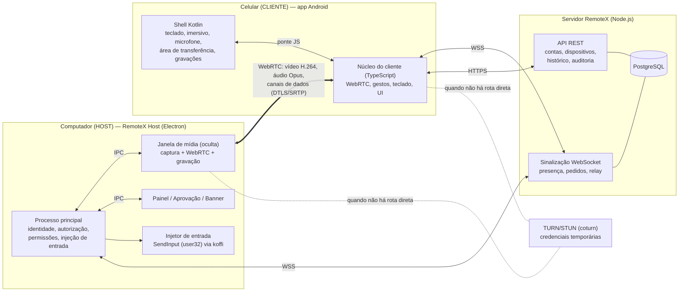

# Arquitetura do RemoteX

RemoteX é uma solução de desktop remoto em que o **computador Windows é o HOST (controlado)** e o
**celular Android é o CLIENTE (controlador)**. Este documento descreve a arquitetura, as decisões
técnicas e por que foram tomadas.

## Visão geral



A mídia (tela, áudio, teclado e mouse) **nunca passa pelo servidor de aplicação**: trafega por
WebRTC diretamente entre PC e celular (mesma rede Wi-Fi ou internet com NAT traversal) ou, quando não
há rota direta, por um servidor TURN que apenas repassa pacotes já criptografados.

## Decisões técnicas e justificativas

### 1. Host Windows em Electron (Chromium/libwebrtc) + TypeScript

A sugestão inicial era C#/.NET ou C++. Avaliamos:

| Opção | Captura | Codificação | Transporte/rede | Risco |
|---|---|---|---|---|
| C# + SIPSorcery + FFmpeg | Desktop Duplication manual | FFmpeg (empacotar binários) | WebRTC em C# (sem GCC maduro) | alto |
| C++ + libwebrtc nativa | WGC/DXGI | HW via MF | completo | altíssimo (build do libwebrtc) |
| **Electron (Chromium)** | **WGC/DXGI do Chromium** | **H.264 por hardware (Media Foundation), VP8/VP9/AV1** | **libwebrtc completo: GCC, NACK, FEC, ICE** | **baixo** |

A pilha do Chromium é a mesma base técnica do Chrome Remote Desktop/Google Meet: captura via Windows
Graphics Capture (com fallback DXGI), **codificação H.264 por hardware** (NVENC/QuickSync/AMF via Media
Foundation), controle de congestionamento adaptativo, retransmissão (NACK), ICE/STUN/TURN e captura de
áudio do sistema por *loopback*. Reimplementar isso em C# levaria meses e seria menos estável.

O único código específico do Windows é a **injeção de entrada**, feita com as APIs oficiais da user32
(`SendInput`, `GetCursorPos`, `GetGUIThreadInfo`, `LockWorkStation`) e da shell32 (`ShellExecuteW
"runas"` para o UAC), chamadas por FFI (koffi — binários pré-compilados, sem compilador C++).
Esse código fica atrás da interface `InputInjector`, com uma segunda implementação para Linux/X11
(XTest), o que permite **testar o sistema inteiro de ponta a ponta** em Linux sob Xvfb.

Custos aceitos: o host ocupa ~120 MB instalado e ~150–250 MB de RAM.

### 2. App Android = shell nativo Kotlin + núcleo do cliente em TypeScript

O núcleo do cliente (WebRTC, gestos, teclado remoto, telas) é TypeScript rodando no WebView do
sistema (Chromium), que decodifica H.264 por hardware (MediaCodec). O shell Kotlin integra as APIs
nativas: teclado do sistema (`InputMethodManager`), modo imersivo, orientação, tela sempre ligada,
vibração, área de transferência, permissão de microfone em tempo de execução e gravação em
`Filmes/RemoteX` (MediaStore).

Vantagens: o mesmo cliente funciona em qualquer navegador (inclusive iPhone e tablets, via
`https://SEU_SERVIDOR/`), e todo o fluxo é **testado automaticamente** com Playwright emulando um
celular com tela de toque — algo impossível com uma UI 100 % nativa sem emulador.

### 3. Backend Node.js + PostgreSQL + WebSocket + coturn

- **API REST (Express 5)**: registro de dispositivos, contas (opcionais), lista de computadores com
  status online, histórico, auditoria, administração de usuários, credenciais TURN temporárias.
- **Sinalização (WebSocket)**: presença, pedidos de conexão por ID, retransmissão de mensagens
  ponta a ponta entre os dois participantes, limites de taxa.
- **PostgreSQL**: dispositivos, usuários, refresh tokens, sessões e auditoria.
- **coturn**: TURN com credenciais HMAC que expiram (padrão "TURN REST API").
- **Redis**: não é necessário numa instância. Os limitadores de taxa estão em memória atrás de uma
  interface; para escalar horizontalmente, troque por Redis e use pub/sub para a sinalização.

### 4. Autenticação ponta a ponta (o servidor não decide quem entra no PC)

O computador só cria a conexão WebRTC (e só revela seus IPs) **depois** de autorizar o celular.
Métodos (detalhes em [SEGURANCA.md](SEGURANCA.md)):

- **Aprovação manual** por quem está no PC, com escolha de permissões;
- **Senha de acesso não assistido**: desafio/resposta com scrypt + HMAC (a senha nunca trafega);
- **Dispositivo confiável**: assinatura Ed25519 com a chave do celular aprovada previamente.

Após a conexão, uma **amarração de canal** prova que ambos veem as mesmas impressões DTLS (anti-MITM)
e um **código de verificação de 6 dígitos** aparece no PC e no celular.

## Mapa de módulos

| Pasta | Conteúdo |
|---|---|
| `windows-host/` | Programa HOST (Electron): `src/main` (núcleo), `src/renderer/engine` (mídia), `src/renderer/ui` (painel) |
| `android-app/` | App Android: `app/` (Kotlin), `web/` (núcleo do cliente em TypeScript), `tools/build-apk.sh` |
| `backend/` | Servidor HTTP (Express), configuração, serviços de contas/histórico/auditoria |
| `signaling-server/` | Protocolo e servidor de sinalização WebSocket |
| `media-engine/` | Protocolo dos canais de dados, qualidade adaptativa, estatísticas, codecs |
| `authentication/` | Senha (scrypt/HMAC), chaves Ed25519, amarração DTLS, JWT, hash de senhas de conta |
| `device-management/` | Registro de dispositivos e IDs de 9 dígitos |
| `remote-input/` | Mapa de teclas, despachante com permissões, gestos, touchpad, diff do IME, injetores Windows/Linux |
| `screen-capture/` | Geometria de monitores (normalizado ↔ pixels, desktop virtual do Windows) |
| `audio/` | Presets de áudio (Opus) e restrições do microfone |
| `recording/` | Gravação com MediaRecorder (pausa, qualidade, formato) |
| `admin/` | RPC de administração remota (dispositivos, permissões, histórico, elevação) |
| `security/` | Permissões, limitadores de taxa/bloqueio, validação, credenciais TURN |
| `database/` | Conexão PostgreSQL e migrações |
| `shared/` | Codificação, IDs, eventos, utilitários de DOM |
| `tests/` | Testes unitários, integração (PostgreSQL/WebSocket/X11) e ponta a ponta |
| `deploy/` | Dockerfile, Docker Compose (PostgreSQL, servidor, coturn, Caddy/HTTPS) |
| `documentation/` | Esta documentação |

## Fluxo de uma conexão

```mermaid
sequenceDiagram
  participant C as Celular
  participant S as Servidor
  participant H as Computador
  C->>S: hello (ID + token do celular)
  H->>S: hello (ID + token do PC) — presença online
  C->>S: connect(hostId, nonce do celular)
  S->>H: session.incoming (dados do celular)
  H->>C: auth.hello (métodos, nonce do PC, assinatura Ed25519 do PC)
  Note over C: confere assinatura e chave fixada do PC
  C->>H: auth.password / auth.device / auth.approval (assinado)
  Note over H: verifica prova; ou pede aprovação na tela
  H->>C: auth.result (permissões)
  H->>C: SDP offer (vídeo H.264, áudio, canais de dados)
  C->>H: SDP answer + candidatos ICE
  H-->>C: WebRTC conectado (direto ou via TURN)
  H->>C: welcome (assinatura sobre as impressões DTLS + código)
  C->>H: bind (prova sobre as mesmas impressões)
  Note over C,H: sessão ativa: banner no PC, controle liberado
```

## Desempenho e latência

- **Vídeo**: H.264 preferido (hardware nos dois lados), `contentHint = detail` para texto nítido,
  presets Alta (60 fps/12 Mbps), Equilibrada (30 fps/5 Mbps), Econômica (15 fps/1 Mbps) e
  **Automática**, que reavalia a cada 2 s banda disponível, perda e RTT (rebaixa em 2 amostras ruins,
  promove após 5 boas). Telas acima de 1920 px são reduzidas fora do modo "resolução original".
- **Entrada**: dois canais de dados — `control` (confiável, ordenado) para cliques/teclas e `motion`
  (sem retransmissão) para movimentos, que nunca acumulam atraso. Cliques carregam a posição.
- **Medido no teste ponta a ponta** (mesma máquina, rede local): latência de entrada 8–25 ms; latência
  ida-e-volta completa *toque → injeção → captura → codificação → rede → decodificação* com mediana
  de **65–90 ms** (codificação por software OpenH264 no ambiente de teste; com hardware tende a ser menor).
